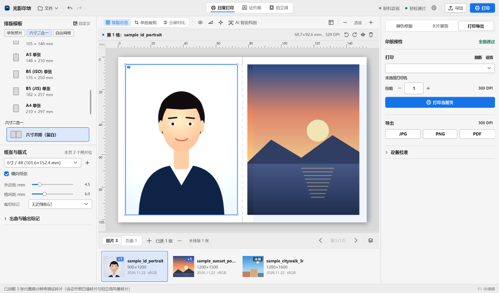
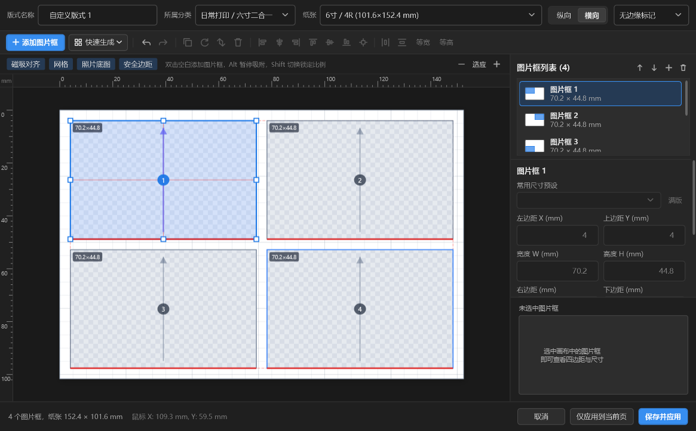
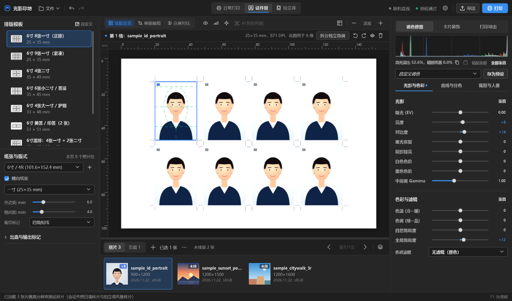

# 光影印坊 PhotoPrintStudio

Windows 离线照片排版、修图与打印工具。为日常照片、证件照和拍立得风格卡片选择实际尺寸的纸张，批量排版，检查后直接打印或导出 JPG、PNG、多页 PDF。

[下载 Windows x64 便携版](https://github.com/Jabofish/PhotoPrintStudio/releases/latest)　|　[使用手册](docs/使用手册.md)　|　[1.0.1 更新内容](docs/releases/1.0.1.md)　|　[反馈问题](https://github.com/Jabofish/PhotoPrintStudio/issues/new/choose)



## 从导入到出片

1. **选纸张和版式。** 顶栏切换「日常打印」「证件照」或「拍立得」。左侧选模板、纸张和裁切标记。
2. **把照片排进页面。** 支持拖入照片或整个文件夹。按模板自动分页、智能构图，或只加入素材池。底栏「照片」用于找图、框选和批量放置，「页面」用于浏览、复制、排序和删除打印页。
3. **在画布上微调。** 直接拖动照片调整取景，双击进入「单图裁剪」。右侧集中提供光影、曲线、HSL 分色、换底、卡片装饰与打印导出。
4. **检查并输出。** 在预检中核对照片分辨率与版面尺寸，再选择打印当前页或全部页面。按 `F1` 查看按用途分组的快捷键。

| 任务 | 适用功能 |
| --- | --- |
| 日常照片 | 常见相纸尺寸、六寸二合一、左对齐裁切、批量分页 |
| 证件照 | 多规格混排、离线人脸与五官定位、模型切换换底、白底裁切角标 |
| 拍立得风格卡片 | 常见实体卡片尺寸、边框颜色、日期签名和批量同步样式 |
| 联机监视 | 接收相机传到本地文件夹的照片，启动时可带入已有照片或只接收后续新增 |

## 可视化自定义排版

在左侧「排版模板」旁点「自定义」。可从网格或现有版式起步，在画布拖动、对齐和分布照片框，也可在右侧按毫米输入位置和尺寸。版式可应用到当前页，也可另存为模板。



<details>
<summary>查看证件照、拍立得与曲线修图工作区</summary>

### 证件照排版



### 拍立得风格卡片


### 单图裁剪与曲线


</details>

以上界面使用 1.0.1 实际截取，照片均为软件生成的示例，可从「文件 → 载入示例照片」打开。

## 下载安装与升级

1. 从 [GitHub Releases](https://github.com/Jabofish/PhotoPrintStudio/releases/latest) 下载 `PhotoPrintStudio-版本-win-x64.zip`，完整解压后运行 `PhotoPrintStudio.exe`。
2. 使用 Windows 11 x64，或使用 Microsoft 仍支持 .NET 10 的 Windows 10 x64 版本。ZIP 自带 .NET 和离线模型。缺少 VC++ x64 运行库时请从 Microsoft 下载。[系统要求](https://learn.microsoft.com/dotnet/core/install/windows#supported-versions)　[VC++ 运行库](https://learn.microsoft.com/cpp/windows/latest-supported-vc-redist)
3. 升级前先保存并退出旧版，再把旧版的 `portable_data` 复制到新版。软件会询问是否恢复临时工程。存放在数据目录之外的原图也需要保留，换电脑可用「打包工程与原图」。

发布的 ZIP 由 GitHub Actions 构建。下载后可核对同一版本提供的 SHA-256，亦可通过 GitHub CLI 验证构建来源。

```powershell
Get-FileHash .\PhotoPrintStudio-1.0.1-win-x64.zip -Algorithm SHA256
gh attestation verify .\PhotoPrintStudio-1.0.1-win-x64.zip --repo Jabofish/PhotoPrintStudio
```

## 实际尺寸打印

打印前确认版面纸张与驱动纸型一致。软件会检查照片框能否完整放进可打印区域。需要无边距精确打印时，请用同一种纸型和驱动设置核对测试卡。爱普生 L8050 可在驱动的无边距设置里选择「保持大小」。[打印校准步骤](docs/使用手册.md#二物理尺寸校准与热升华防吃边)

## 从源代码构建

在 Windows x64 安装 [指定版本的 .NET SDK](global.json) 和 PowerShell 7，然后在仓库根目录运行。

```powershell
pwsh -File scripts/build_portable.ps1
```

构建脚本按版本和 SHA-256 获取模型，运行测试，将便携 ZIP 和校验值输出到 `dist/`。开发时可先运行 `pwsh -File scripts/fetch-models.ps1`，再通过 `dotnet run --project src/PhotoPrintStudio.App` 启动。要在开发版使用离线模型，可把 `assets/models` 中的文件复制到程序旁的 `portable_data/models`。

## 本地数据与许可

照片、工程和模型推理在本机处理。反馈问题时可使用内置样片。截图、工程和日志可能包含照片、文件路径或设备名称，请在上传前检查。

项目自有源码采用 [MIT](LICENSE)。模型、.NET 组件和其他依赖遵循各自的许可，权重版本与来源见[第三方声明](THIRD-PARTY-NOTICES.md)。
