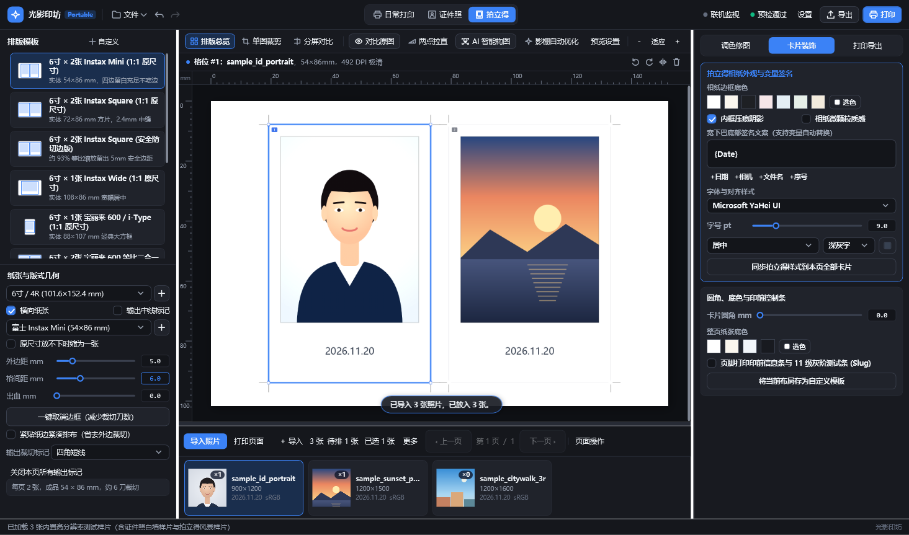
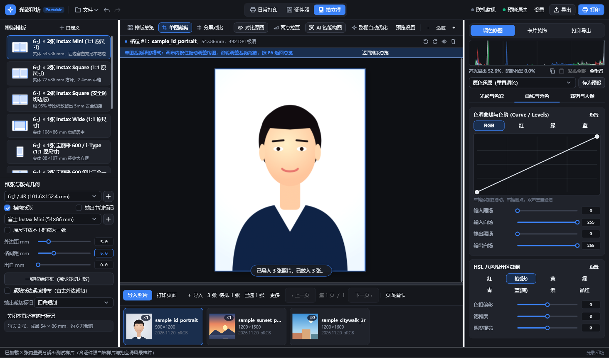

# 光影印坊 PhotoPrintStudio

面向 Windows 的离线照片排版、修图和打印工具。把日常照片、证件照或拍立得风格卡片排到实际尺寸的纸张上，预检后打印，也可批量导出 JPG、PNG 或多页 PDF。

[下载 Windows x64 便携版](https://github.com/Jabofish/PhotoPrintStudio/releases/latest)　|　[使用手册](docs/使用手册.md)　|　[反馈问题](https://github.com/Jabofish/PhotoPrintStudio/issues/new/choose)


## 下载安装

1. 在 [GitHub Releases](https://github.com/Jabofish/PhotoPrintStudio/releases/latest) 下载 `PhotoPrintStudio-版本-win-x64.zip`。
2. 完整解压到有写入权限的文件夹，打开 `PhotoPrintStudio.exe`。
3. 使用 Windows 11 x64，或使用 Microsoft 仍支持 .NET 10 的 Windows 10 x64 版本（见[系统要求](https://learn.microsoft.com/dotnet/core/install/windows#supported-versions)）。ZIP 自带 .NET 和离线模型。Windows 如缺少 VC++ x64 运行库，请从 [Microsoft 官方页面](https://learn.microsoft.com/cpp/windows/latest-supported-vc-redist) 安装。

发布 ZIP 由 GitHub Actions 构建。可在下载页面核对 SHA-256，或使用 GitHub CLI 验证 ZIP 对应的仓库和构建记录。

```powershell
Get-FileHash .\PhotoPrintStudio-1.0.0-win-x64.zip -Algorithm SHA256
gh attestation verify .\PhotoPrintStudio-1.0.0-win-x64.zip --repo Jabofish/PhotoPrintStudio
```

## 从导入到输出

1. **选版式。** 在「日常打印」「证件照」「拍立得」中选择适合的成品尺寸和纸张。
2. **导入并排版。** 可选自动分页、智能导入或仅加入素材池。在排版总览直接拖动照片微调位置。
3. **检查并输出。** 核对页序、DPI、留白和裁切标记。使用物理打印时，可先打测试卡校准实际尺寸。

| 场景 | 可以做什么 |
| --- | --- |
| 日常打印 | 常用单张尺寸、六寸二合一、自定义网格、批量导入分页和按页管理 |
| 证件照 | 多规格和混排、离线人脸与五官定位、可切换模型的换底、白底裁切角标 |
| 拍立得风格卡片 | 常见卡片尺寸、边框颜色、签名变量和自定义模板 |
| 修图与输出 | 单图裁剪、分屏对比、曲线与 HSL、打印预检、DPI 设置、打印机校准、JPG/PNG/PDF 导出 |
| 联机监视 | 监视本地文件夹，开始时选择导入已有照片或只接收新增文件 |

<details>
<summary>查看证件照、拍立得和曲线编辑界面</summary>

**证件照排版**


**拍立得风格卡片**



**单图裁剪与曲线**



</details>

截图中的人像和风景均由程序生成。「文件」菜单内可加载同样的样片体验排版。

## 本地数据

照片编辑、排版和模型推理在本机完成。应用数据存放在程序目录的 `portable_data`。升级前退出程序，再将旧版数据目录复制到新版。工程引用的数据目录之外的原图也需要保留，跨电脑分享可使用「打包工程与原图」。

反馈问题时请使用不含个人信息的样片。截图、工程和日志可能包含照片、文件路径或设备名称，请在上传前检查。

## 从源代码构建

在 Windows x64 安装 [`global.json` 指定的 .NET SDK](global.json) 和 PowerShell 7，然后在仓库根目录运行。

```powershell
pwsh -File scripts/build_portable.ps1
```

脚本按版本和 SHA-256 获取模型，运行测试并生成 `dist/` 下的便携 ZIP 和校验值。开发时可先运行 `pwsh -File scripts/fetch-models.ps1`，再通过 `dotnet run --project src/PhotoPrintStudio.App` 启动。开发版需要离线模型时，可把 `assets/models` 中的文件复制到开发版程序旁的 `portable_data/models`。

## 许可

项目自有源码采用 [MIT](LICENSE)。随包分发的模型、.NET 组件和其他依赖遵循各自的许可，完整清单、权重版本和来源见 [第三方声明](THIRD-PARTY-NOTICES.md)。
