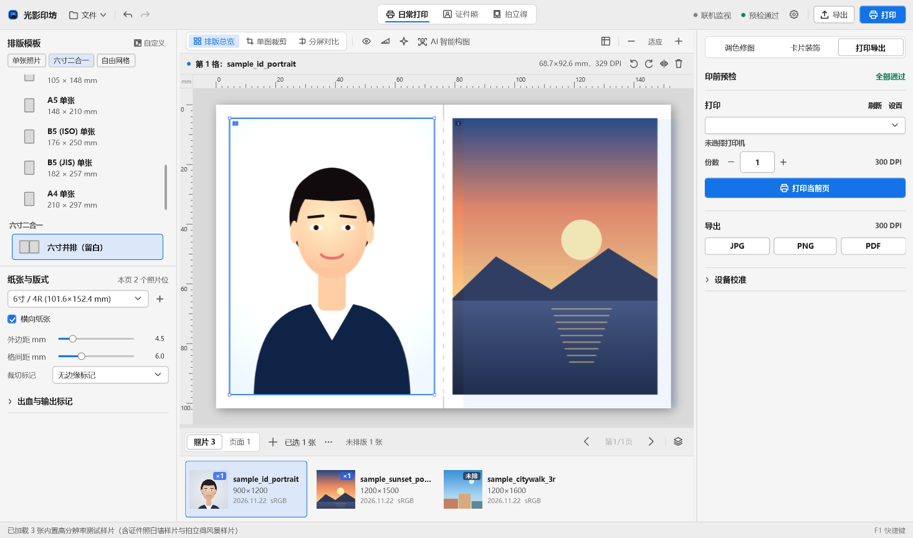
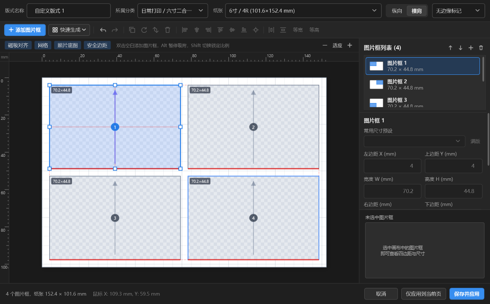

# 光影印坊 PhotoPrintStudio 使用手册

## 一、认识工作区

顶栏用于切换「日常打印」「证件照」「拍立得」。左侧是模板、纸张和裁切标记，中间是画布和视图工具，右侧分为「调色修图」「卡片装饰」「打印导出」。底栏「照片」用于放置素材，「页面」用于管理实际会打印或导出的页面。

### 批量导入和页面管理

先选版式，再导入照片（也支持直接拖入整个照片文件夹）。可选「填入本页空位」「自动分页」「智能导入」或「仅加入素材池」。六寸二合一导入 10 张会提示排成 5 页，已有排版时会为本次照片追加新页；若当前页还有空位，可直接填入本页空位。证件照还可选择每张单独一页、每页印多份。单张模板会按照片自动选横纸或竖纸。

多格模板可选择按模板顺序、横向优先（从左到右逐行）或纵向优先（从上到下逐列）。「照片适配」可统一选择裁切填满格位或完整显示、允许留白。版式的纸张外边距仍由左栏控制。素材池内已选的照片可从「已选 N 张」或右键菜单打开「选择排版策略」、填入本页或批量粘贴调色。

底栏「照片」显示已导入的数量，未放进排版的照片会以「未排」标出；点击「未排版 N 张」可一键选中全部未排版照片，右键已排版照片可「定位到所在页面」。双击底栏照片可快速放入空位或替换当前格；选中多张照片后可直接整体拖到画布按顺序铺放。从空白处拖动可框选，按住 Alt 可从照片卡片开始框选，Ctrl+拖动可追加选择。Ctrl+A 全选，Delete 从工程移除所选照片，右键菜单支持清空本页照片、移除未排版照片或清空全部素材（均支持 Ctrl+Z 撤销）。切到「页面」查看排版缩略图，点击任意页可跳转，右键或按 Alt+← / Alt+→ 可调整页面顺序，右键还可复制、清空或删除所选页，Delete 删除所选页。工程至少保留一页。两个页签都支持滚轮横向浏览。

### 按场景选择版式

1. **证件照**：在顶栏选「证件照」，左侧可选「6寸 8张一寸（正排）」等规格。双击有图的格位可进入「单图裁剪」，右侧「裁剪与人像」提供五官辅助线和白墙提纯。
2. **日常打印**：顶部选择「日常打印」，可在左侧跳转到单张照片、六寸二合一或自由网格。单张模板自动设置纸张，每页排一张，默认四边各留白 5 mm 且无输出标记。批量导入时选择按版式分页，即可让每张照片各占一页。需要满幅时可手动将外边距调为 0。六寸二合一也提供左对齐裁切、满幅和上下双图排版。
3. **拍立得**：在顶栏选「拍立得」，按左侧模板所示的实际尺寸和张数排版。右侧「卡片装饰」可编辑边框颜色和签名，支持 `{Date}` 与 `{Camera}` 变量，也可将当前卡片样式同步到本页或全部页面。

拍立得默认按所选卡片的原尺寸排版。若要固定每页张数，可新建拍立得排版模板，选择「指定行列，必要时等比缩小」，保存前核对实际张数和成品尺寸。

### 可视化自定义排版

1. 点击左侧「排版模板」旁的「自定义」，在编辑器顶栏选择纸张与方向。
2. 用「添加图片框」手动放置，或通过「快速生成」从均分网格、常用尺寸或已有模板起步。拖动时可使用磁吸和网格，多选后可用工具栏对齐、分布或设为等宽等高。
3. 在右侧选中一个图片框，按毫米输入位置和尺寸。完成后选「仅应用到当前页」，或通过「保存并应用」「另存为新模板」保留版式。

### 裁剪、调色与换底

在排版总览中，可直接拖动已放入格位的照片来调位置，按住 Alt 拖动格位可与另一格位互换或移动照片，把指针放在照片上按 Shift+滚轮调缩放；画布放大后可按住鼠标中键平移视图。单击照片后也可使用右侧的裁剪参数，双击有图格位进入详细裁剪，双击空白格位可直接导入照片放入该格，右键画布可清空当前格或清空本页全部照片。

日常打印和拍立得可按「AI 智能构图」调整当前照片，或在批量导入时选择「智能导入」。有人像时优先保留人物，无人像时分析细节和色彩分布。智能导入默认开启「自动旋转」，照片与固定格位横竖方向相反时可旋转 90°，可取消勾选。计算中可按「取消构图」；完成后，选中照片即可按「还原构图」。

在右侧「裁剪与人像」的换底区可切换「换底模型」。GitHub 便携版提供 Pas、Hivision MODNet 和 BiRefNet 768，默认使用 Pas。软件会记住所选模型。

「输出裁切标记」和中线标记会写入图片、PDF 和打印成品。想交付无标记版本时，请使用「关闭本页所有输出标记」；画布上的选中框和边距参考虚线不会输出。

## 二、物理尺寸校准与热升华防吃边

- 爱普生 L8050 无边距打印需要精确尺寸时，请在驱动首选项的「主窗口」勾选「无边距」，打开旁边的「设置」，将放大方法设为「保持大小」。软件的「优先使用无边距纸型」只影响纸型选择。选择「自动扩展」时，驱动会放大照片并裁去纸边以外的区域。
- 在打印导出页打开校准向导。使用与成品相同的纸型、方向和驱动设置打印测试卡，量取横、纵标尺端线中心之间的距离。
- 输入实测毫米数，点击「计算 X/Y 缩放」并保存。再打印一张测试卡，核对调整后的尺寸。
- 无边距扩张由打印机驱动决定。实体无边距作业需要先完成当前设置的尺寸校准。尺寸校准按打印机、纸型、方向、DPI 和驱动设置分别保存。旧版共用的尺寸补偿需要用当前设置重新测量并保存。
- 打印机会留出硬件边距时，贴边的照片框可能放不进可打印区域。程序会提示调整留白或选择支持该纸型无边距的驱动设置。

## 三、常用设置

顶栏「设置」分为外观、画布预览、打印与导出、高级四页。主题可选浅色、深色或跟随系统。标尺、参考线和溢出提示只影响画布；输出标记仍在左栏控制。打印和导出默认 300 DPI，JPG 默认采用最高品质 100，需要时可在设置中选择 600 DPI。

Alt+1 至 Alt+3 切换右栏。Alt+Shift+1 至 Alt+Shift+3 切换调色修图下的三个页签。Alt+4 至 Alt+7 依次聚焦模板、画布、照片素材和打印页面。

点击画布或按 Alt+5 后，用方向键翻页，Home 和 End 跳到首页或末页。Ctrl+G 输入页码，Ctrl+Shift+N 新增空白页，Ctrl+Shift+D 复制当前页。Ctrl+= 和 Ctrl+- 缩放画布，Ctrl+0 适应窗口。G 查看排版总览，R 进入单图裁剪，Y 开关分屏对比，J 开关高光和暗部溢出提示，Shift+T 启用或退出两点拉直。Ctrl+[ 和 Ctrl+] 将当前照片逆时针或顺时针旋转 90°。

Tab 聚焦滑块后，方向键微调，按住 Shift 一次调整十步，Enter 或 F2 输入精确数值，Alt+Backspace 将当前参数恢复为默认值。聚焦自定义模板或调色预设时，F2 重命名。Ctrl+E 导出当前页 JPG，Ctrl+Shift+E 打开导出菜单。按 F1 查看按用途分组的完整列表。

临时工程可按 Ctrl+S 保存，正常关闭时也会自动保存。下次打开时可选择恢复或重新开始。在工作中，可用「文件 → 新建空白工程」（Ctrl+N）开始新任务。需要单独的工程文件时，选择「文件 → 另存为」，之后 Ctrl+S 会写回该文件。分享给其他电脑时，选择「打包工程与原图」，将生成的工程和同目录的素材文件夹一起发送。

升级时，先保存工作并退出旧版，再把旧版 `portable_data` 的内容复制到新版的同名目录。启动新版可继续已保存的临时工程。已另存的工程可从「文件 → 打开排版工程」打开。

工程和原图都放在 `portable_data` 内时，用新版保存后可随数据目录一起搬迁。存放在数据目录外的原图仍由工程引用。如果原图已移动，打开工程时可选择原图所在的文件夹。跨电脑分享单个工程时可使用「打包工程与原图」。
